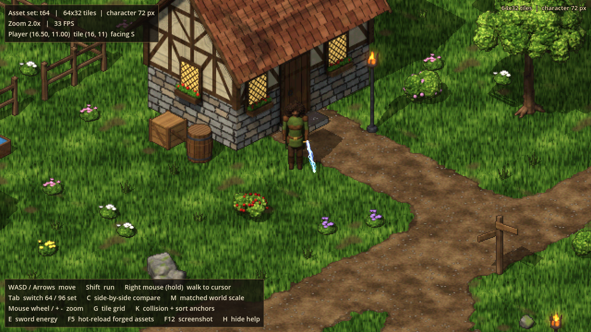

# Isometric Fantasy MMORPG: Visual Laboratory (Milestone 1)

A playable Godot 4 prototype for checking the approved art direction
(see `docs/PROJECT_BRIEF_AND_ART_BIBLE.md` and `docs/reference/`) at real
gameplay resolution before any MMO infrastructure is built.



## What's here

| Path | What it is |
|---|---|
| `game/` | Godot 4.3 project (GDScript, GL Compatibility renderer) |
| `tools/forge/` | **Sprite Forge**: Python pre-renderer that produces every calibration asset at both native resolutions |
| `game/assets/generated/t64`, `t96` | Forged sprites for the 64×32 and 96×48 tile sets, each with a `manifest.json` |
| `game/data/maps/homestead.json` | Hand-placed homestead map (terrain corners + props) |
| `game/data/props.json` | Resolution-independent prop data (collision, sort mode) |
| `PROJECT_STATE.md` | **Current state of the project**: slices, verification status, known issues |
| `docs/INTERACTION_SYSTEMS.md` | Commands, item/inventory data structures and transfer invariants (Slice 002) |
| `docs/PROTOTYPE_STATUS.md` | Slice 001 report: calibration findings and open art decisions |
| `game/tests/run_tests.gd` | Headless tests for the item/interaction authority |

## Run it

1. Install **Godot 4.3+** (standard build, not .NET).
2. Open `game/project.godot` and press F5, or run `godot --path game`.

The forged PNGs are committed, so you don't need Python to play.

### Controls

| Input | Action |
|---|---|
| WASD / arrow keys | Move (8 directions; diagonals follow the tile axes) |
| Shift | Run |
| Right mouse (hold) | Walk toward the cursor |
| Mouse wheel, `+` / `-` | Zoom: 0.5×, 1×, 1.5×, 2×, 3×, 4× |
| Tab (or 1 / 2) | Switch between the 64×32 and 96×48 asset sets |
| C | Side-by-side comparison of both sets |
| M | In compare mode, switch between native pixels and matched world scale |
| G | Tile grid overlay |
| K | Collision shapes and depth-sort anchors |
| E | Toggle the sword energy effect |
| F5 | Hot-reload forged assets from disk (after re-running the forge) |
| F12 | Screenshot to `user://` |
| H / F1 | Show or hide the help panel |
| Left click | Select a world object and show its name |
| Double-click | Use: open or close doors, open chests, pick up ground items; in a slot, equip or unequip |
| Drag | Move items between ground, backpack, chest and equipment; Shift-drag moves one item from a stack |
| I / B | Backpack window |
| P | Equipment window |
| F2 | UI scale: 1×, 1.5×, 2× |

## Regenerating art

```bash
pip install -r tools/forge/requirements.txt
python3 tools/forge/build.py              # both sets, ~3 min on 4 cores
python3 tools/forge/build.py --only player,cottage --sets 96
python3 tools/forge/mapgen.py             # rewrites the homestead map
python3 tools/forge/contact_sheet.py      # docs/images/readability_*.png
python3 tools/forge/ui_art.py             # leather/parchment UI textures + cursors
python3 tools/forge/sfx.py                # placeholder sound effects
```

Then press F5 in the running game to reload.

## Tests

```bash
# item/interaction authority (no window needed)
godot --headless --path game --script res://tests/run_tests.gd
# full acceptance run through real mouse/keyboard input + screenshots
xvfb-run godot --rendering-driver opengl3 --path game -- --scenario=acceptance --shot_dir=/tmp/shots [--set=t96]
```

Both exit with code 0 when everything passes. After adding new `class_name` scripts, run
`godot --headless --editor --quit --path game` once so the class cache is refreshed.

## Headless screenshots (CI / review)

```bash
xvfb-run godot --rendering-driver opengl3 --path game -- \
    --shot=/tmp/out.png --frames=60 --set=t96 --zoom=2 --pos=16.5,11 [--compare] [--matched] [--grid] [--collision] [--nohelp] [--face=0..7] [--walk=0..7]
```
